<p align="center">
  
</p>

<p align="center">
  <a href="https://x.com/Mxsports5"></a>
  <a href="https://github.com/AsadNoul"></a>
  
  
</p>

<p align="center">
  
</p>


## 👋 About Me

I'm **Asad** — a Dubai-based builder working where **AI, automation and crypto** meet.
I founded **NaulX**, an AI automation agency that helps early-stage startups replace manual work with bots, agents and workflows.
By day I lead **Demand Generation at Bitunix Exchange** — KOL campaigns across 🇮🇳 India, 🇵🇰 Pakistan and 🇧🇷 Brazil, SEO/content and conversion funnels.
I've traded crypto for **8 years**, and I build the tools I trade with: indicators, screeners, signal bots and a signals app.

```yaml
name:        Asad Ali Naul
based_in:    Dubai, UAE 🇦🇪
building:    [NaulX AI Automation, MassLiveTrades / IIT Trading Academy, ProfitWave]
day_job:     Demand Generation Manager @ Bitunix Exchange
previously:  [NAQDI Group, Avafive Group, Cyberg Digital Media]
superpower:  "Growth marketer who can actually ship the code"
currently:   Building AI agents & Claude Skills that run whole workflows end-to-end
```


## 🛰️ What I Do

<p align="center">
  
</p>

<table>
<tr>
<td width="33%" valign="top">

### 🤖 AI Automation
I take repetitive business work and turn it into systems that run 24/7.

- **Lead capture → AI qualification → CRM**, fully hands-off
- **Telegram, WhatsApp & Discord bots** for onboarding and support
- **AI DM classifiers** that sort intent (signals vs. education vs. support)
- **n8n workflows** linking Sheets, Discord, Telegram & APIs
- **Source tracking** — know if a user came from TikTok, Meta or X
- **Self-healing webhooks** & monitoring so nothing goes down quietly

</td>
<td width="33%" valign="top">

### 🧩 AI Skills & Agent Builder
I build reusable AI "skills" — packaged know-how that agents can run on demand.

- **Custom Claude Skills & plugins** for content, ads and research
- **MCP connectors** to plug AI into Gmail, Drive, HubSpot, n8n & more
- **Content agents** — scripts, hooks, captions, ad copy in brand voice
- **Video & reel pipelines** with consistent motion-brand styles
- **Research & reporting agents** — data in, decisions out
- **Prompt systems** built to be tested, versioned and reused

</td>
<td width="33%" valign="top">

### 📈 Crypto Signals Provider
8 years in the market, sharing setups with my communities.

- **Futures & spot signals** — BTC, majors, alts & **XAUUSD**
- **Telegram / Discord VIP** via MassLiveTrades & IIT Trading Academy
- **ProfitWave** — my Crypto & Gold signals app on Google Play
- **Custom Pine v6 indicators** — trend, momentum, order flow, OBs
- **Multi-TF screener** (4h / 8h / 12h / 1D) with auto alerts
- **Education first** — risk management before entries

</td>
</tr>
</table>


## ⚙️ Automations in Action

<p align="center">
  
</p>


## 🚀 Featured Builds

| | Project | What it does | Stack |
|:-:|---|---|---|
| 🧠 | **Telegram AI Lead Tracker** | Reads inbound DMs, classifies intent with AI, logs every lead to Google Sheets | Python · Telegram API · LLM · Sheets |
| 💬 | **WhatsApp Qualification Bot** | Qualifies inquiries, pitches free signup, collects UID, onboards to Discord | WhatsApp Business API · n8n |
| 👋 | **Source-Tagged Welcome Bot** | DMs every new channel joiner a personal welcome, tagged by traffic source | Telegram · Sheets |
| 🔁 | **Signal Relay Engine** | Telegram ➜ Discord signal reformatting + paper-execution testing | Python · Discord · Telegram |
| 📰 | **Crypto News Digest Bot** | Scheduled crypto news digest posted to Discord | n8n · RSS · AI summaries |
| 🎥 | **TikTok Live Join Tracker** | Logs who joins my TikTok lives to SQLite + Sheets | Python · SQLite |
| 📡 | **Bitunix Multi-TF Screener** | Momentum dashboard across 4h/8h/12h/1D with alert bot | Python · Exchange API |
| 📊 | **GTE + OF + OB** | HMA trend engine, ADX/DI momentum, order-flow imbalance & order blocks | Pine Script v6 |
| ⚡ | **Apex Scalper** | Multi-timeframe (5/15/30m) cross-market scalping indicator | Pine Script v6 |
| 📲 | **ProfitWave** | Crypto & Gold (XAUUSD) signals app, live on Google Play | Android |
| 🎬 | **seats.ae** | Best-seat finder for UAE cinemas (VOX, Reel, Novo, Roxy) | Web app |
| 📰 | **CryptoRemacX** | Crypto news, education & exchange-review site | Web · SEO |
| 🎓 | **IIT Trading Academy** | Trading academy site + multilingual MassLiveTrades landing page | WordPress |
| 📺 | **TV Home Launcher** | Ad-free custom home screen for Samsung Tizen TVs | Tizen · JS |


## 📣 Growth & Paid Media

<table>
<tr>
<td width="50%" valign="top">

**What I run**
- 🌍 **KOL programs** across India, Pakistan & Brazil
- 🎯 **Google Ads** — incl. Chinese-language campaigns (AU + APAC)
- 📘 **Meta Ads** — user acquisition for crypto education brands
- 🐦 **X Ads + email** lifecycle for crypto cashback products
- 🔎 **SEO & content** strategy for exchanges
- 🧪 **Funnels** — landing page → bot → community → conversion

</td>
<td width="50%" valign="top">

**Career path**
```
2026 ▸ Demand Gen Manager — Bitunix Exchange
     ▸ Founder — NaulX (AI automation agency)
     ▸ MassLiveTrades / IIT Trading Academy
 ... ▸ NAQDI Group
 ... ▸ Avafive Group
 ... ▸ Cyberg Digital Media, Dubai
```

</td>
</tr>
</table>


## 🧰 Tech Stack

<p align="center"><b>Languages & Frameworks</b><br/><br/>
  
</p>
<p align="center"><b>Data, Infra & Tools</b><br/><br/>
  
</p>
<p align="center"><b>AI, Automation & Marketing</b><br/><br/>
  
  
  
  
  
  
  
  
  
  
  
</p>


## 🔥 GitHub Activity

<p align="center">
  
</p>

<p align="center">
  <picture>
    <source media="(prefers-color-scheme: dark)" srcset="https://raw.githubusercontent.com/AsadNoul/AsadNoul/output/github-snake-dark.svg"/>
    
  </picture>
</p>


## 🤝 Work With Me

<table>
<tr>
<td align="center" width="25%">🔍<br/><b>1. Audit</b><br/><sub>Map the manual work eating your team's time</sub></td>
<td align="center" width="25%">🧠<br/><b>2. Design</b><br/><sub>Pick the bots, agents & skills that pay off fastest</sub></td>
<td align="center" width="25%">⚙️<br/><b>3. Build</b><br/><sub>Ship working automations, not slide decks</sub></td>
<td align="center" width="25%">📈<br/><b>4. Scale</b><br/><sub>Monitor, self-heal and grow with your funnel</sub></td>
</tr>
</table>

<p align="center">
  <b>Startups that want AI automation · Exchanges that want growth · Traders who want better tools</b>
  <br/><br/>
  <a href="https://x.com/Mxsports5"></a>
</p>

<p align="center"><sub>⚠️ Signals & indicators are shared for education — not financial advice. Trade responsibly.</sub></p>

<p align="center">
  
</p>
